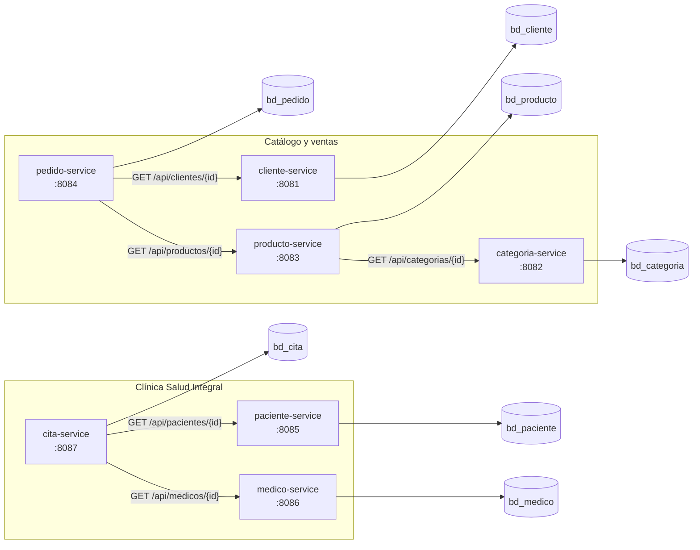
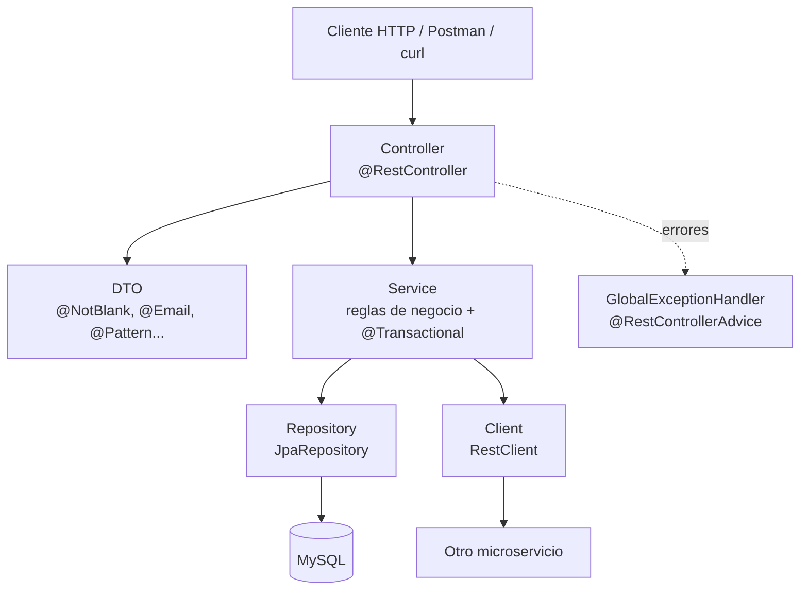
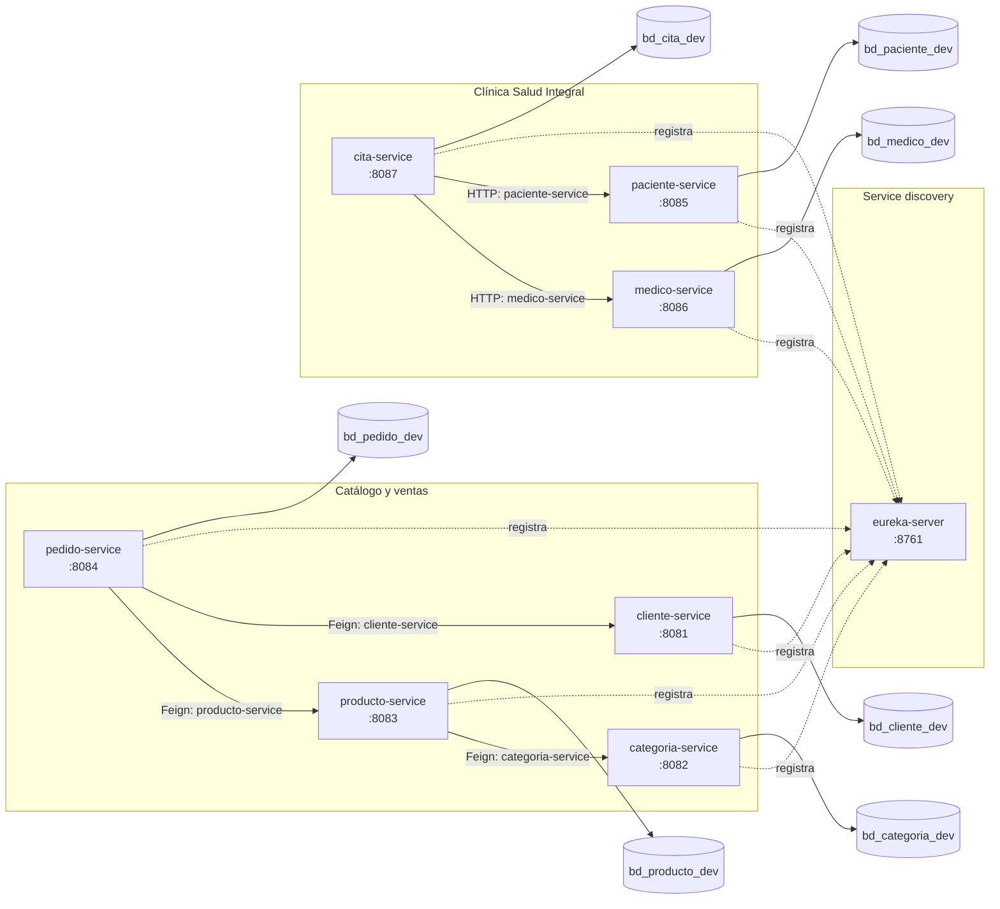

---
tags:
  - glab-s11
  - arquitectura
  - microservicios
  - mermaid
fecha: 2026-11-01
estado: completado
---

# 02 · Arquitectura de microservicios

> [!quote] Idea central
> Un microservicio es un servicio pequeño, desplegable de forma independiente, dueño de sus datos y comunicado por contratos (HTTP/JSON). En este laboratorio hay **7 servicios** y **7 bases de datos**.

## Diagrama de servicios, puertos y bases de datos

> [!important] Regla de oro
> Cada servicio es dueño de su esquema. **No hay acceso directo a la BD de otro servicio** ni FK cruzadas. La integridad se valida por HTTP.

## Arquitectura por capas (igual en los 7 servicios)

| Capa | Paquete | Responsabilidad |
|---|---|---|
| Controller | `com.tecsup.controller` | Exponer endpoints, validar con `@Valid`, decidir status 200/201 |
| DTO | `com.tecsup.dto` | Contrato de entrada, validaciones Bean Validation |
| Service | `com.tecsup.services` | Reglas de negocio, transacciones, orquestación |
| Repository | `com.tecsup.repository` | Acceso a datos con Spring Data JPA |
| Model | `com.tecsup.model` | Entidades JPA |
| Exception | `com.tecsup.exception` | Excepciones propias + handler global |
| Client | `com.tecsup.client` | Comunicación HTTP con otros servicios |

## Monolito vs microservicios (con este laboratorio)

| Criterio | Monolito | Microservicios (este lab) |
|---|---|---|
| Despliegue | Un solo artefacto | 7 jars independientes, puertos 8081–8087 |
| Base de datos | Una BD compartida | Una BD por servicio (`bd_*`) |
| Escalado | Escala todo el bloque | Escala solo producto o cita si hace falta |
| Falla de un módulo | Puede tumbar toda la app | Aísla la falla; se traduce a 503 |
| Transacciones | ACID local sencillo | Sin transacción distribuida; se valida por HTTP y se compensa |
| Complejidad | Baja | Alta: configuración, red, observabilidad, contratos |
| Acoplamiento | Alto entre módulos | Bajo: contratos HTTP y DTOs |
| Cohesión | Difusa | Alta: cada servicio hace una cosa |

### Ventajas observadas

- **Aislamiento de fallos:** al detener `producto-service`, `pedido-service` respondió **503 JSON** sin stack trace; el resto siguió funcionando.
- **Despliegue independiente:** se puede reconstruir y reiniciar solo `cita-service`.
- **Esquemas independientes:** `cita` no puede hacer FK a `paciente` porque están en BDs distintas; se valida por HTTP.
- **Equipos paralelos:** cada servicio tiene su propio `pom.xml`, configuración y dueño.

### Desventajas observadas

- **Más configuración:** 7 `pom.xml`, 7 `application.yml`, 7 puertos.
- **Latencia y fallos de red:** una cita depende de dos llamadas HTTP.
- **Integridad distribuida:** si `paciente-service` cae después de validar, la cita puede quedar con una referencia “huérfana”; se mitiga con validación previa y manejo 503.
- **Duplicación de infraestructura:** cada servicio repite handler, excepciones y configuración JPA.
- **Depuración más compleja:** hay que revisar logs de varios procesos.

> [!example] Ejemplo concreto de bajo acoplamiento
> `pedido-service` no conoce las tablas de `cliente-service`. Solo conoce el contrato `GET /api/clientes/{id}`. Si mañana cliente cambia su BD, pedido no se entera mientras el contrato HTTP se mantenga.

> [!example] Ejemplo concreto de alta cohesión
> `categoria-service` solo gestiona categorías. No sabe de productos, pedidos ni clientes. Su repositorio, DTO y validaciones giran alrededor de una sola entidad.

## Decisiones arquitectónicas del laboratorio

1. **Un puerto por servicio** (8081–8087) y **una BD por servicio**.
2. **DTOs** en todos los servicios; las entidades no se usan como contrato de entrada.
3. **Handler global** en cada servicio para 400/404/409/500/503.
4. **RestClient** para llamadas HTTP, con URL en `application-dev.yml`.
5. **Sin FK cruzadas en la clínica**: `cita.id_paciente` e `cita.id_medico` son columnas simples.
6. **FK internas sí se mantienen**: `medico → especialidad`, `horario_medico → medico`, `atencion → cita`.
7. **Perfiles** `dev` (BD `*_dev`) y `prod` (host `servidor`, fallo esperado).
8. **Cancelar no borra**: cambia estado y conserva historia.

## Enlaces

- [[03 categoria-service]]
- [[04 producto-service]]
- [[05 cliente-service]]
- [[06 pedido-service]]
- [[07 paciente-service]]
- [[08 medico-service]]
- [[09 cita-service]]
- [[13 Conceptos clave]]

## S12 · Arquitectura con Eureka y OpenFeign

> [!info] Diagrama actualizado
> El diagrama anterior mostraba llamadas HTTP directas. Desde S12 los servicios se descubren por **Eureka** y las llamadas se hacen por **OpenFeign** usando el nombre lógico.

> [!important] Reglas que no cambian
> - Sin relaciones JPA entre microservicios.
> - Sin compartir bases ni consultar la BD de otro servicio.
> - Comunicación solo por REST (OpenFeign en producto y pedido).

Enlaces: [[18 Eureka y service discovery]] · [[19 OpenFeign]] · [[20 Comunicación entre servicios (flujo GET pedido)]]
