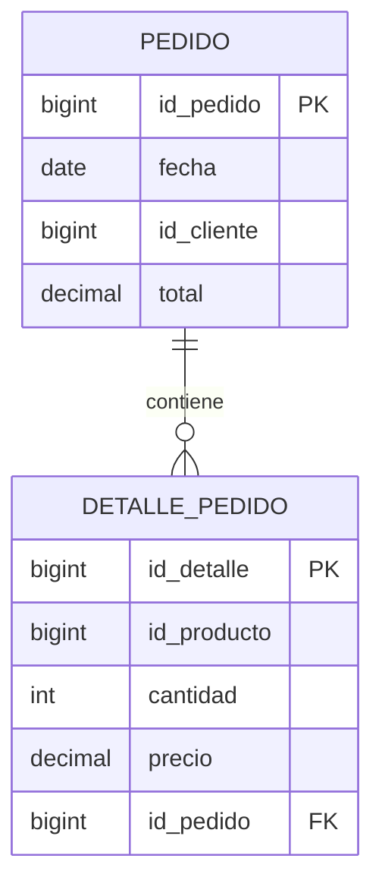

---
tags:
  - glab-s11
  - servicio
  - pedido
  - jpa
  - restclient
fecha: 2026-11-01
estado: completado
---

# 06 · pedido-service

> [!info] Ficha
> **Puerto:** 8084 · **BD:** `bd_pedido` (dev: `bd_pedido_dev`) · **Perfil prod:** 9095

## Responsabilidad

Registrar pedidos con sus detalles, validando por HTTP que el cliente y cada producto existan.

## Modelo



| Entidad | Campos |
|---|---|
| `Pedido` | `idPedido`, `fecha`, `idCliente`, `total`, `detalles` |
| `DetallePedido` | `idDetalle`, `idProducto`, `cantidad`, `precio`, `pedido` |

## El problema de la recursión infinita

La guía define una relación bidireccional:

```text
Pedido 1 --- N DetallePedido
DetallePedido N --- 1 Pedido
```

Al serializar, Jackson entra en:

```text
Pedido → detalles → DetallePedido → pedido → detalles → ...
```

**Solución aplicada:** `@JsonIgnore` en `DetallePedido.pedido`.

```java
@ManyToOne
@JoinColumn(name = "id_pedido")
@JsonIgnore
private Pedido pedido;
```

Resultado real (sin recursión):

```json
{
  "idPedido": 1,
  "fecha": "2026-06-10",
  "idCliente": 1,
  "total": 3679.80,
  "detalles": [
    {"idDetalle": 1, "idProducto": 1, "cantidad": 1, "precio": 3500.00},
    {"idDetalle": 2, "idProducto": 2, "cantidad": 2, "precio": 89.90}
  ]
}
```

> [!warning] Alternativas
> También se pudo usar `@JsonManagedReference`/`@JsonBackReference` o DTOs de salida. Se eligió `@JsonIgnore` por ser la opción mínima y suficiente.

## DTO y validación

`PedidoDTO`:

- `fecha` `@NotNull`
- `idCliente` `@NotNull`
- `detalles` `@NotEmpty`, `@Size(max=50)`, `@Valid`

`DetallePedidoDTO`:

- `idProducto` `@NotNull`
- `cantidad` `@NotNull @Min(1)`
- `precio` `@NotNull @DecimalMin(0.0)`

El JSON de la guía trae `total`; se ignora y **se recalcula en el servidor**:

```java
total = total.add(precio.multiply(BigDecimal.valueOf(cantidad)));
```

Así el total nunca queda inconsistente con los detalles.

## Actualización de detalles (decisión)

La guía no actualizaba los detalles. Aquí:

```java
pedido.getDetalles().clear();
// se agregan los nuevos detalles
```

Con `orphanRemoval = true`, Hibernate elimina los anteriores e inserta los nuevos. Es un **reemplazo completo**, no un merge por `idDetalle`. Documentado para que el cliente sepa que debe enviar la lista completa.

## Comunicación HTTP

| Dependencia | URL configurable | Si 404 | Si está caído |
|---|---|---|---|
| cliente-service | `servicios.cliente.url` | 404 JSON | 503 JSON |
| producto-service | `servicios.producto.url` | 404 JSON | 503 JSON |

## Endpoints

| Método | Ruta | Éxito | Errores |
|---|---|---|---|
| GET | `/api/pedidos` | 200 | 500 |
| GET | `/api/pedidos/{id}` | 200 | 404 |
| POST | `/api/pedidos` | 201 | 400, 404, 503 |
| PUT | `/api/pedidos/{id}` | 200 | 400, 404, 503 |
| DELETE | `/api/pedidos/{id}` | 200 | 404 |

## Resultados reales

| Caso | Status |
|---|---|
| Pedido 1 (cliente 1, productos 1 y 2) | 201, total 3679.80 |
| Pedido 2 (cliente 2, productos 2 y 3) | 201, total 579.78 |
| Cliente 999 | 404 |
| producto-service detenido | 503 |
| GET 999 | 404 |

## Enlaces

- [[05 cliente-service]]
- [[04 producto-service]]
- [[12 Pruebas HTTP]]
- [[14 Guía original y problemas detectados]]

## S12 · pedido-service refactorizado (IDs + estado + OpenFeign)

> [!important] Cambio de modelo
> El pedido de S11 guardaba `fecha`, `total` y una lista de `DetallePedido`. En S12 guarda **solo** `clienteId`, `productoId`, `cantidad` y `estado`. Se eliminaron `DetallePedido` y `DetallePedidoDTO`, y se recreó la tabla `pedido` en `bd_pedido_dev` (se eliminó `detalle_pedido`).

### Entidad

```java
@Entity
@Table(name = "pedido")
public class Pedido {
    @Id @GeneratedValue(strategy = GenerationType.IDENTITY)
    @Column(name = "id_pedido") private Long idPedido;
    @Column(name = "cliente_id", nullable = false)  private Long clienteId;
    @Column(name = "producto_id", nullable = false) private Long productoId;
    @Column(nullable = false) private Integer cantidad;
    @Column(nullable = false, length = 20) private String estado = PENDIENTE;
}
```

Sin `@ManyToOne` ni relaciones JPA cruzadas.

### Endpoints

| Método | Ruta | Descripción |
|---|---|---|
| GET | `/api/pedidos` | Listado con cliente/producto (tolera fallos) |
| GET | `/api/pedidos/{id}` | Pedido + cliente + producto |
| POST | `/api/pedidos` | Crea en estado PENDIENTE (201) |
| PUT | `/api/pedidos/{id}/anular` | PENDIENTE → ANULADO |
| PUT | `/api/pedidos/{id}/atender` | PENDIENTE → ATENDIDO |

> [!warning] Sin DELETE
> `DELETE /api/pedidos/{id}` fue eliminado. Un pedido se anula; no se borra.

### OpenFeign

- `ClienteClient` (`@FeignClient(name="cliente-service")`) → `GET /api/clientes/{id}`.
- `ProductoClient` (`@FeignClient(name="producto-service")`) → `GET /api/productos/{id}`.
- `ClienteDTO` (`id`, `nombre`, `apellido` con `@JsonAlias("apellidos")`).
- `ProductoDTO` (`id`, `nombre`, `precio`, tolerante a `categoria`).
- `PedidoResponseDTO` (`id`, `cantidad`, `estado`, `cliente`, `producto`).

### Validación y errores

- `clienteId` y `productoId` obligatorios; `cantidad` mayor a cero (`@Valid` + `@NotNull`/`@Min`).
- Cliente/producto inexistente → **404** con mensaje específico.
- Transición inválida → **409** (`ConflictException`).
- Servicio caído → **503**; error genérico → **500**.
- Listado con servicio caído → **200** con el dato remoto en `null`.

### Respuesta real

```json
{"cantidad":2,"cliente":{"apellido":"Ramirez","id":6,"nombre":"Carlos"},
 "estado":"PENDIENTE","id":1,"producto":{"id":9,"nombre":"Laptop","precio":2500.00}}
```

Enlaces: [[20 Comunicación entre servicios (flujo GET pedido)]] · [[19 OpenFeign]] · [[12 Pruebas HTTP]]
