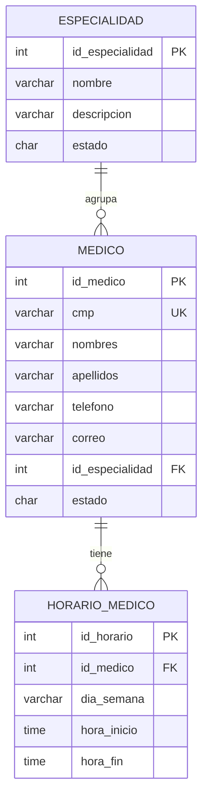

---
tags:
  - glab-s11
  - servicio
  - clinica
  - medico
fecha: 2026-11-01
estado: completado
---

# 08 · medico-service

> [!info] Ficha
> **Puerto:** 8086 · **BD:** `bd_medico` (dev: `bd_medico_dev`) · **Perfil prod:** 9097

## Responsabilidad

Administrar médicos, especialidades y horarios. `cita-service` lo consulta para validar `idMedico`.

## Entidades (3 tablas en la misma BD)

> [!important] FK interna permitida
> `medico.id_especialidad` y `horario_medico.id_medico` sí son FK porque viven en la **misma** BD (`bd_medico`). No se cruzan microservicios.

## Validaciones

| DTO | Reglas |
|---|---|
| `MedicoDTO` | `cmp` 5–6 dígitos y único, nombres/apellidos obligatorios, teléfono 9 dígitos, correo válido, `idEspecialidad` obligatorio |
| `EspecialidadDTO` | nombre obligatorio, descripción ≤200, estado A/I |
| `HorarioMedicoDTO` | día válido (LUNES…DOMINGO), horaInicio/horaFin obligatorias; `horaFin > horaInicio` se valida en el service |

## Endpoints

| Método | Ruta | Éxito | Errores |
|---|---|---|---|
| GET | `/api/medicos` | 200 | 500 |
| GET | `/api/medicos/{id}` | 200 | 404 |
| POST | `/api/medicos` | 201 | 400, 404, 409 |
| PUT | `/api/medicos/{id}` | 200 | 400, 404, 409 |
| DELETE | `/api/medicos/{id}` | 200 | 404 |
| GET | `/api/especialidades` | 200 | 500 |
| POST | `/api/especialidades` | 201 | 400 |
| GET | `/api/especialidades/{id}` | 200 | 404 |
| PUT | `/api/especialidades/{id}` | 200 | 400, 404 |
| DELETE | `/api/especialidades/{id}` | 200 | 404, 409 |
| GET | `/api/medicos/{id}/horarios` | 200 | 404 |
| POST | `/api/medicos/{id}/horarios` | 201 | 400, 404 |
| DELETE | `/api/horarios/{id}` | 200 | 404 |

## Decisiones

- **CMP único** → 409 con `DuplicateResourceException`.
- Al eliminar un médico se eliminan primero sus horarios para respetar la FK.
- La especialidad se busca en el repositorio local; si no existe → 404.
- `Medico` expone `idEspecialidad` con `@JsonProperty` y oculta la entidad `Especialidad` con `@JsonIgnore` para no anidar objetos innecesarios.

## Resultados reales

| Caso | Status |
|---|---|
| Crear Cardiología y Pediatría | 201 |
| Crear médicos CMP 45678 y 56789 | 201 |
| Horario LUNES 08:00–12:00 | 201 |
| CMP duplicado | 409 |
| Especialidad inexistente | 404 |

## Enlaces

- [[09 cita-service]] (consumidor)
- [[07 paciente-service]]
- [[12 Pruebas HTTP]]

## S12 · Registro en Eureka (opcional, completado)

- Se agregó `spring-cloud-starter-netflix-eureka-client` + BOM 2025.1.4 y `@EnableDiscoveryClient`.
- Se agregó la sección `eureka:` en `application-dev.yml` (`defaultZone: http://localhost:8761/eureka`).
- No cambió el CRUD ni el puerto.
- Verificado en `/eureka/apps`: aparece **UP** junto con los servicios base.

> [!note] Alcance
> La guía S12 marca este registro como opcional. Se hizo para cumplir el criterio "todos los servicios deben registrarse"; las llamadas de cita-service siguen usando URLs fijas de S11 (no era parte del alcance de OpenFeign de esta actividad).

Enlaces: [[18 Eureka y service discovery]] · [[00 Índice (MOC)]]