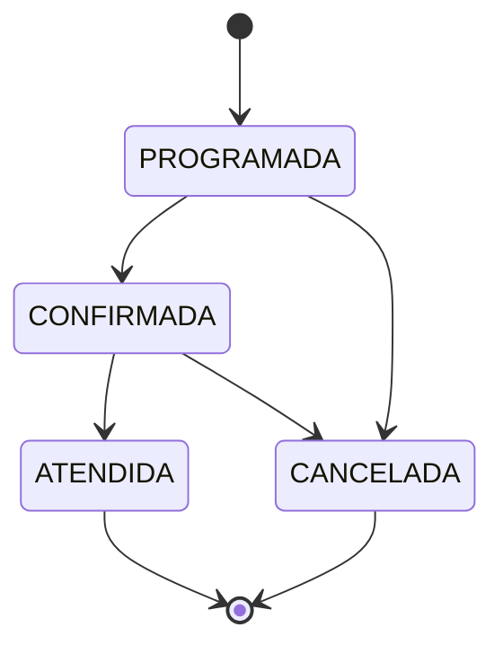

---
tags:
  - glab-s11
  - servicio
  - clinica
  - cita
  - maquina-estados
fecha: 2026-11-01
estado: completado
---

# 09 · cita-service

> [!info] Ficha
> **Puerto:** 8087 · **BD:** `bd_cita` (dev: `bd_cita_dev`) · **Perfil prod:** 9098

## Responsabilidad

Gestionar citas médicas, su ciclo de estados y la atención 1:1 resultante. Valida paciente y médico por HTTP.

## Entidades

```mermaid
erDiagram
    CITA ||--o| ATENCION : genera
    CITA {
        int id_cita PK
        date fecha
        time hora
        int id_paciente "sin FK (otra BD)"
        int id_medico "sin FK (otra BD)"
        varchar motivo
        varchar estado
    }
    ATENCION {
        int id_atencion PK
        int id_cita FK UK
        text diagnostico
        text tratamiento
        text observaciones
        datetime fecha_registro
    }
```

> [!important] Sin FK hacia paciente/médico
> `id_paciente` e `id_medico` son **columnas simples**. No se puede crear una FK porque `paciente` está en `bd_paciente` y `medico` en `bd_medico`. La integridad se valida por HTTP contra los otros servicios. La FK `atencion.id_cita → cita.id_cita` sí existe porque está en la misma BD.

## Máquina de estados



| Estado actual | Estados permitidos |
|---|---|
| PROGRAMADA | CONFIRMADA, CANCELADA |
| CONFIRMADA | ATENDIDA, CANCELADA |
| ATENDIDA | ninguno (terminal) |
| CANCELADA | ninguno (terminal) |

> [!warning] Transición inválida
> `PROGRAMADA → ATENDIDA` devuelve **409**. Para atender hay que confirmar primero. Una cita `ATENDIDA` o `CANCELADA` no cambia más.

## Atención 1:1

Al enviar `estado: ATENDIDA` se exige `diagnostico`; se crea una fila en `atencion` enlazada a la cita.

```json
{
  "estado": "ATENDIDA",
  "diagnostico": "Hipertensión arterial controlada",
  "tratamiento": "Enalapril 10 mg cada 12 horas por 30 días",
  "observaciones": "Paciente estable; control en 15 días."
}
```

Si falta el diagnóstico → **400**. Si la cita ya tiene atención → **409**.

## Endpoints

| Método | Ruta | Éxito | Errores |
|---|---|---|---|
| GET | `/api/citas` | 200 | 500 |
| GET | `/api/citas/{id}` | 200 | 404 |
| POST | `/api/citas` | 201 | 400, 404, 503 |
| PUT | `/api/citas/{id}/estado` | 200 | 400, 404, 409 |
| PUT | `/api/citas/{id}/cancelar` | 200 | 404, 409 |
| GET | `/api/citas/{id}/atencion` | 200 | 404 |

## Validaciones de entrada

- `fecha` `@NotNull @FutureOrPresent` → no se permiten citas en el pasado.
- `hora` `@NotNull`.
- `idPaciente`, `idMedico` `@NotNull` + existencia HTTP.
- `motivo` ≤ 300.
- `estado` del cambio: `@Pattern(PROGRAMADA|CONFIRMADA|ATENDIDA|CANCELADA)`.

## Comunicación HTTP

| Dependencia | URL | 404 | Caído |
|---|---|---|---|
| paciente-service | `servicios.paciente.url` | 404 | 503 |
| medico-service | `servicios.medico.url` | 404 | 503 |

## Resultados reales

| Caso | Status |
|---|---|
| Crear cita 1 (paciente 1, médico 1) | 201 PROGRAMADA |
| Crear cita 2 (paciente 2, médico 2) | 201 PROGRAMADA |
| Confirmar cita 1 | 200 CONFIRMADA |
| Atender cita 1 con diagnóstico | 200 ATENDIDA |
| Consultar atención | 200 con diagnóstico/tratamiento |
| Cancelar cita 2 | 200 CANCELADA |
| Fecha 2020-01-01 | 400 |
| Paciente 999 | 404 |
| Médico 999 | 404 |
| PROGRAMADA → ATENDIDA | 409 |
| Cancelar ATENDIDA | 409 |
| Confirmar CANCELADA | 409 |
| paciente-service detenido | 503 |

> [!note] `GET /api/citas/{id}` no anida la atención
> Se ocultó `Cita.atencion` con `@JsonIgnore` para evitar recursión. La atención se consulta en `GET /api/citas/{id}/atencion`. Es un contrato explícito y evita respuestas gigantes.

## Enlaces

- [[07 paciente-service]]
- [[08 medico-service]]
- [[12 Pruebas HTTP]]
- [[15 Conclusiones]]

## S12 · Registro en Eureka (opcional, completado)

- Se agregó `spring-cloud-starter-netflix-eureka-client` + BOM 2025.1.4 y `@EnableDiscoveryClient`.
- Se agregó la sección `eureka:` en `application-dev.yml` (`defaultZone: http://localhost:8761/eureka`).
- No cambió el CRUD ni el puerto.
- Verificado en `/eureka/apps`: aparece **UP** junto con los servicios base.

> [!note] Alcance
> La guía S12 marca este registro como opcional. Se hizo para cumplir el criterio "todos los servicios deben registrarse"; las llamadas de cita-service siguen usando URLs fijas de S11 (no era parte del alcance de OpenFeign de esta actividad).

Enlaces: [[18 Eureka y service discovery]] · [[00 Índice (MOC)]]