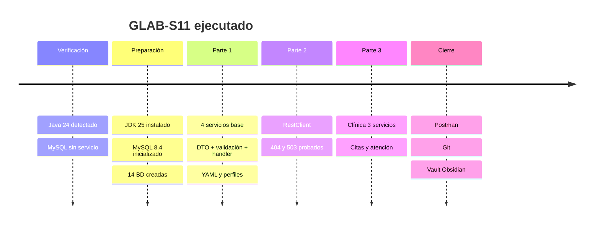

---
tags:
  - glab-s11
  - bitacora
  - pasos
fecha: 2026-11-01
estado: completado
---

# 10 · Bitácora por pasos

> [!info] Cómo leer esta nota
> Cada paso registra **qué hice**, **qué comandos ejecuté**, **qué resultado obtuve** y **por qué**. Los errores están ampliados en [[11 Errores y soluciones]].

## Línea de tiempo



---

## Paso 0 · Verificación del entorno

**Qué hice:** comprobar SO, Java, Maven, MySQL, Git y herramienta HTTP.

```powershell
java -version
mvn -version
Get-Command mysql
Test-NetConnection localhost -Port 3306
```

**Resultado:**

- Windows 11.
- Java **24.0.2** (la guía pide 25).
- Maven 3.9.16.
- MySQL no encontrado y puerto 3306 cerrado.
- Git disponible.

**Por qué:** no se asume nada instalado; el laboratorio exige Java 25 y MySQL en 3306 con root sin contraseña.

**Acción:** instalar JDK 25 y MySQL; ver [[01 Entorno y requisitos]].

---

## Paso 1 · Crear las bases de datos

**Qué hice:** crear las 4 BD de la guía, las 4 `_dev` del paso YAML y las 6 de la clínica.

```sql
CREATE DATABASE bd_categoria;
CREATE DATABASE bd_producto;
CREATE DATABASE bd_cliente;
CREATE DATABASE bd_pedido;
CREATE DATABASE bd_categoria_dev;
CREATE DATABASE bd_producto_dev;
CREATE DATABASE bd_cliente_dev;
CREATE DATABASE bd_pedido_dev;
CREATE DATABASE bd_paciente;
CREATE DATABASE bd_medico;
CREATE DATABASE bd_cita;
CREATE DATABASE bd_paciente_dev;
CREATE DATABASE bd_medico_dev;
CREATE DATABASE bd_cita_dev;
```

**Resultado:** `SHOW DATABASES LIKE 'bd_%'` devolvió las 14.

**Por qué:** cada microservicio debe ser dueño de su esquema; los perfiles `dev` usan las `_dev` para no mezclar datos de pruebas con los de la BD “principal”.

---

## Paso 2 · Revisar los 4 proyectos Maven

**Qué hice:** leer los `pom.xml` y compararlos con la guía.

| Punto | Encontrado | Acción |
|---|---|---|
| Spring Boot | 4.1.2 | Se conserva (patch más nuevo que 4.1.0) |
| Java | 25 | OK |
| Group / package | `com.tecsup` | OK |
| Packaging | jar | OK |
| Web | `spring-boot-starter-webmvc` | Nombre correcto en Boot 4 |
| Data JPA | presente | OK |
| DevTools | presente | OK |
| MySQL Driver | presente | OK |
| Validation | ausente | Se agregó `spring-boot-starter-validation` |
| Clase main duplicada | `com.tecsup.categoria_service` | Se eliminó |

**Por qué:** Spring Boot 4 renombró el starter web; además Initializr había generado una clase main en un subpaquete, lo que hacía fallar `repackage` con “Unable to find a single main class”.

**Resultado:** los 4 proyectos compilaron con `mvn -q -DskipTests package`.

---

## Paso 3 · Estructura de paquetes

**Qué hice:** crear en cada proyecto:

```text
src/main/java/com/tecsup/
├── controller
├── dto
├── exception
├── model
├── repository
└── services
```

**Por qué:** la guía exige esa separación y el paquete `services` en plural. En los servicios que consumen a otros se añadió `client` (capa de infraestructura HTTP), sin romper la estructura pedida.

---

## Paso 4 · categoria-service

**Qué hice:** implementar entidad, DTO, repositorio, service, controller, excepción y handler; agregar validación.

**Comandos:**

```powershell
cd categoria-service
mvn -q -DskipTests package
java -jar target\categoria-service-0.0.1-SNAPSHOT.jar
```

**Pruebas:**

```powershell
curl.exe -s -X POST http://localhost:8082/api/categorias `
  -H "Content-Type: application/json" `
  --data-binary "@postman/bodies/categoria-1.json"
# 201 {"id":1,"nombre":"Laptops","estado":"ACTIVO"}

curl.exe -s http://localhost:8082/api/categorias
# 200 [...]
```

**Resultado:** 201, 200, 400 con DTO vacío, 404 con ID 999.

**Por qué:** es el servicio base y el ejemplo de código de la guía; sirve de plantilla para los demás.

> [!warning] Primer intento de POST con curl
> `curl.exe -d '{"nombre":"Laptops"}'` desde PowerShell envió el JSON sin comillas y devolvió 400. **Solución:** usar `--data-binary "@archivo.json"`. Ver [[11 Errores y soluciones]].

---

## Paso 5 · cliente-service y producto-service

**Qué hice:** como la guía no trae código, replicar la arquitectura de categoría.

- **Cliente:** nombre, apellidos, dirección, teléfono, `nroDni` único, estado. Validaciones de DNI (8), teléfono (9), estado.
- **Producto:** nombre, precio `BigDecimal`, stock, `categoriaId`. Validación de categoría por HTTP.

**Pruebas:**

```powershell
# clientes
curl.exe ... http://localhost:8081/api/clientes
# productos
curl.exe ... http://localhost:8083/api/productos
```

**Resultado:** 201 al crear, 409 al repetir DNI, 404 si `categoriaId` no existe, 503 si categoría está caída.

**Por qué:** mantener el mismo estilo (controller → service → repository) reduce la curva de aprendizaje y hace el código predecible.

---

## Paso 6 · pedido-service y recursión

**Qué hice:** implementar `Pedido`, `DetallePedido`, repositorio, service, controller y DTOs.

**Problema:** la relación bidireccional producía recursión infinita al serializar.

**Solución:** `@JsonIgnore` en `DetallePedido.pedido`.

```java
@ManyToOne
@JoinColumn(name = "id_pedido")
@JsonIgnore
private Pedido pedido;
```

**Prueba:**

```powershell
curl.exe -s -X POST http://localhost:8084/api/pedidos `
  -H "Content-Type: application/json" `
  --data-binary "@postman/bodies/pedido-1.json"
# 201, JSON con detalles y sin "pedido" anidado
```

**Resultado:** pedido 1 total 3679.80; pedido 2 total 579.78.

**Por qué:** el cliente necesita ver los detalles, pero no que cada detalle repita el pedido completo.

---

## Paso 7 · Pruebas con los JSON de la guía

**Qué hice:** cargar los datos en el orden pedido: categorías → productos → clientes → pedidos.

| Orden | Servicio | Resultado |
|---|---|---|
| 1 | Categorías (3) | 201, IDs 1–3 |
| 2 | Productos (3) | 201, IDs 1–3 |
| 3 | Clientes (2) | 201, IDs 1–2 |
| 4 | Pedidos (2) | 201, IDs 1–2 |

**Por qué:** respetar el orden evita referencias inexistentes; productos necesitan categorías y pedidos necesitan clientes/productos.

---

## Paso 8 · Migración a YAML y perfiles

**Qué hice:** reemplazar `application.properties` por:

```text
application.yml        → spring.profiles.active: dev
application-dev.yml    → puerto, BD _dev, JPA, empresa.ambiente
application-prod.yml   → puerto 9092 (categoría), host servidor
```

**Corrección importante:** en la guía `jpa:` estaba al mismo nivel que `spring:`. Se movió **dentro** de `spring:`:

```yaml
spring:
  datasource:
    url: jdbc:mysql://localhost:3306/bd_categoria_dev
    username: root
    password: ""
  jpa:
    hibernate:
      ddl-auto: update
    show-sql: true
```

**Prueba dev:**

```powershell
curl.exe -s http://localhost:8082/api/categorias
# []  → BD _dev vacía
curl.exe -s -X POST ... --data-binary "@categoria-1.json"
# 201 → confirma que escribe en bd_categoria_dev
```

**Resultado:** los 4 servicios arrancaron con perfil `dev` y escribieron en las BD `_dev`.

**Por qué:** los perfiles permiten separar configuración sin recompilar; `dev` usa datos de prueba y `prod` simula un servidor real.

---

## Paso 9 · Perfil prod (fallo esperado)

**Qué hice:** arrancar categoría con `--spring.profiles.active=prod`.

```powershell
java -jar target\categoria-service-0.0.1-SNAPSHOT.jar --spring.profiles.active=prod
```

**Resultado:**

```text
The following 1 profile is active: "prod"
Tomcat initialized with port 9092 (http)
...
UnknownHostException: Host desconocido (servidor)
Failed to initialize JPA EntityManagerFactory
```

**Por qué:** el perfil prod apunta a `jdbc:mysql://servidor/...`, un host que no existe. Es lo esperado: demuestra que el perfil se selecciona y que el puerto 9092 se configura antes de fallar la conexión.

> [!success] Verificado
> El log confirma `profile "prod"` y `port 9092`. No se consideró un error del laboratorio.

---

## Paso 10 · Comunicación entre microservicios

**Qué hice:** agregar `RestClient` con URL configurable.

| Consumidor | Valida | URL |
|---|---|---|
| producto-service | categoría | `servicios.categoria.url` |
| pedido-service | cliente | `servicios.cliente.url` |
| pedido-service | producto | `servicios.producto.url` |
| cita-service | paciente | `servicios.paciente.url` |
| cita-service | médico | `servicios.medico.url` |

**Pruebas de error:**

```powershell
# detener categoria-service
Stop-Process -Id (Get-NetTCPConnection -LocalPort 8082 -State Listen).OwningProcess -Force
curl.exe -s -X POST http://localhost:8083/api/productos ... 
# 503 {"codigo":"503","mensaje":"categoria-service no está disponible..."}
```

```powershell
# detener producto-service
curl.exe -s -X POST http://localhost:8084/api/pedidos ...
# 503 {"codigo":"503","mensaje":"producto-service no está disponible..."}
```

```powershell
# detener paciente-service
curl.exe -s -X POST http://localhost:8087/api/citas ...
# 503 {"codigo":"503","mensaje":"paciente-service no está disponible..."}
```

**Resultado:** 404 cuando el recurso remoto no existe; 503 cuando el servicio está caído; siempre JSON, sin stack trace.

**Por qué:** en microservicios la red falla; el consumidor debe degradar de forma controlada.

---

## Paso 11 · Clínica: bases y proyectos

**Qué hice:** crear `paciente-service` (8085), `medico-service` (8086) y `cita-service` (8087) con la misma configuración Maven/Java/Spring Boot.

**BD:** `bd_paciente`, `bd_medico`, `bd_cita` + `_dev`.

**Por qué:** la actividad pide 3 microservicios independientes; se mantiene la coherencia con la Parte 1.

---

## Paso 12 · Clínica: modelo y reglas

**Qué hice:**

- `paciente`: DNI único, correo, fecha de nacimiento pasada.
- `medico`: CMP único, especialidad (FK local), horarios (FK local).
- `cita`: fecha/hora, paciente/médico como columnas simples, estado, atención 1:1.

**Decisión clave:** no crear FK `cita.id_paciente` ni `cita.id_medico` porque las tablas están en otras BD. Se validan por HTTP.

**Máquina de estados:**

```text
PROGRAMADA → CONFIRMADA | CANCELADA
CONFIRMADA → ATENDIDA   | CANCELADA
ATENDIDA   → terminal
CANCELADA  → terminal
```

**Por qué:** una cita atendida o cancelada no debe “revivir”; conservar historia es requisito de negocio.

---

## Paso 13 · Pruebas de la clínica

**Orden:** pacientes → especialidades → médicos → horarios → citas.

| Prueba | Resultado |
|---|---|
| 2 pacientes | 201 |
| 2 especialidades | 201 |
| 2 médicos | 201 |
| 1 horario | 201 |
| 2 citas | 201 |
| Confirmar cita 1 | 200 |
| Atender cita 1 con diagnóstico | 200 |
| Consultar atención | 200 |
| Cancelar cita 2 | 200 |
| Fecha pasada | 400 |
| DNI/CMP duplicado | 409 |
| Paciente/médico inexistente | 404 |
| Transición inválida | 409 |
| Servicio caído | 503 |

**Resultado:** todos los casos coincidieron con lo esperado. Ver [[12 Pruebas HTTP]].

---

## Paso 14 · Postman y cuerpos JSON

**Qué hice:** generar dos colecciones v2.1 importables y guardar los cuerpos usados por `curl`.

```text
postman/
├── GLAB-S11-Microservicios.postman_collection.json
├── GLAB-S11-Clinica.postman_collection.json
└── bodies/*.json
```

**Por qué:** el informe suele pedir evidencia en Postman; las colecciones permiten reejecutar todo sin reconstruir requests a mano.

> [!tip] No se usó la GUI
> Las pruebas se ejecutaron con `curl.exe`; las colecciones se validaron con `ConvertFrom-Json` y quedan listas para importar.

---

## Paso 15 · Git y bitácora

**Qué hice:** `git init` y commits locales por avance:

```text
chore: estructura Maven, perfiles YAML, scripts de ejecucion y bases de datos
feat: microservicios de categorias, productos, clientes y pedidos...
feat: sistema de citas con paciente, medico, especialidad, horario, cita y atencion
docs: colecciones Postman de microservicios y clinica
```

**Por qué:** dejar historia revisable y no perder el avance. No se hizo push.

**Bitácora:** este vault, con notas atómicas y enlaces.

---

## Enlaces

- [[11 Errores y soluciones]]
- [[12 Pruebas HTTP]]
- [[14 Guía original y problemas detectados]]
- [[15 Conclusiones]]
