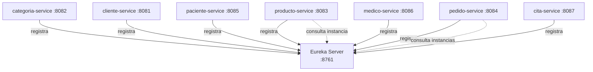

---
tags:
  - glab-s12
  - eureka
  - service-discovery
  - microservicios
fecha: 2026-11-05
estado: completado
---

# 18 · Eureka y service discovery

> [!quote] Idea central
> Con muchos servicios y puertos, un cliente no debería tener URLs fijas. **Eureka** es el registro donde cada servicio publica dónde está, y los demás lo consultan por **nombre lógico** (`producto-service`, `cliente-service`, …).

## ¿Qué problema resuelve?

Sin discovery:

```text
pedido-service --> http://localhost:8083  (URL fija en application.yml)
```

Si producto cambia de host o puerto, hay que editar y redeployar pedido. Con Eureka:

```text
pedido-service --> "producto-service" --> Eureka devuelve la instancia viva --> http://localhost:8083
```

Ventajas reales en este laboratorio:

- No hay URLs fijas en `producto-service` ni en `pedido-service`.
- Se pueden levantar varias instancias del mismo servicio.
- Si una instancia cae, deja de renovar su *lease* y Eureka la expulsa.

## Servidor Eureka (`eureka-server`)

- Puerto **8761**.
- `@EnableEurekaServer` en `EurekaServerApplication` (paquete `com.tecsup`).
- `application.yaml`:

```yaml
server:
  port: 8761

spring:
  application:
    name: eureka-server

eureka:
  client:
    register-with-eureka: false
    fetch-registry: false
  server:
    enable-self-preservation: false
```

> [!note] `register-with-eureka: false`
> El servidor no se registra a sí mismo. `fetch-registry: false` evita que intente descargar un registro que él mismo provee.

Verificación:

```powershell
Invoke-WebRequest http://localhost:8761/ -UseBasicParsing   # HTTP 200
Invoke-WebRequest http://localhost:8761/eureka/apps -Headers @{Accept='application/json'} -UseBasicParsing
```

## Clientes Eureka (los 7 servicios)

Cada servicio tiene:

```java
@SpringBootApplication
@EnableDiscoveryClient
public class XxxServiceApplication { ... }
```

Y en `application-dev.yml`:

```yaml
spring:
  application:
    name: producto-service   # nombre lógico que verán los demás

eureka:
  client:
    register-with-eureka: true
    fetch-registry: true
    service-url:
      defaultZone: http://localhost:8761/eureka
    registry-fetch-interval-seconds: 5
    disable-delta: true
  instance:
    hostname: localhost
    prefer-ip-address: false
    lease-renewal-interval-in-seconds: 5
    lease-expiration-duration-in-seconds: 10
```

> [!tip] Ajustes de desarrollo
> Los valores por defecto de Eureka son 30 s para renovar y 90 s para expirar. En desarrollo se bajaron a **5 s / 10 s** para que un servicio caído desaparezca rápido. `disable-delta: true` fuerza a traer el registro completo cada 5 s y evita cachés vacías cuando varios servicios arrancan en paralelo.

## Orden de arranque

```text
1. eureka-server        :8761
2. categoria-service    :8082
3. cliente-service      :8081
4. producto-service     :8083
5. pedido-service       :8084
6. paciente-service     :8085
7. medico-service       :8086
8. cita-service         :8087
```

`run\start-all.ps1` hace exactamente esto: compila (opcional), levanta Eureka, espera el puerto 8761, y luego cada servicio esperando su puerto antes del siguiente.

## Evidencia de registro

`GET http://localhost:8761/eureka/apps` (Accept: `application/json` o `application/xml`) devolvió:

```text
CLIENTE-SERVICE   -> UP
PRODUCTO-SERVICE  -> UP
PEDIDO-SERVICE    -> UP
MEDICO-SERVICE    -> UP
CITA-SERVICE      -> UP
PACIENTE-SERVICE  -> UP
CATEGORIA-SERVICE -> UP
```

> [!warning] Trampa real encontrada
> Al levantar los 4 servicios casi al mismo tiempo, `pedido-service` arrancó con el registro vacío y su primer Feign devolvió **503**. Se corrigió de dos formas: (1) arranque secuencial con espera, y (2) `disable-delta: true` + `registry-fetch-interval-seconds: 5`. Ver [[11 Errores y soluciones]].

## Diagrama



## Enlaces

- [[17 Decisión de versiones Boot 4 + Spring Cloud 2025.1.x]]
- [[19 OpenFeign]]
- [[20 Comunicación entre servicios (flujo GET pedido)]]
