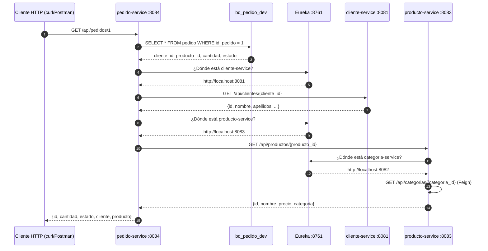
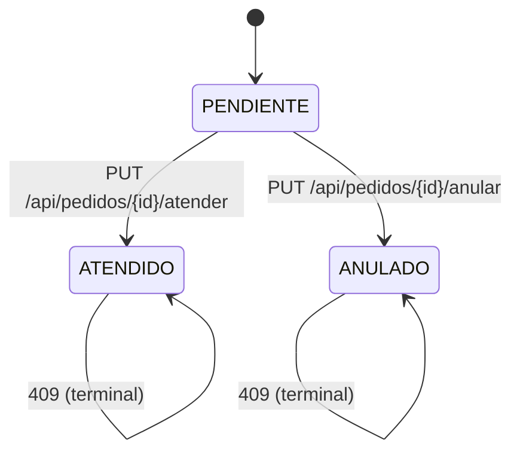

---
tags:
  - glab-s12
  - comunicacion
  - pedido
  - mermaid
fecha: 2026-11-05
estado: completado
---

# 20 · Comunicación entre servicios (flujo GET pedido)

> [!quote] Objetivo
> `GET /api/pedidos/{id}` debe devolver los datos del pedido (BD propia) **más** el cliente y el producto obtenidos por OpenFeign desde sus servicios. Todo en una sola respuesta JSON.

## Flujo paso a paso



> [!note] Dos saltos Feign
> El pedido llama a producto, y producto a su vez llama a categoría. El DTO `ProductoDTO` del pedido ignora el campo `categoria` gracias a `@JsonIgnoreProperties(ignoreUnknown = true)`.

## Respuesta real obtenida

```json
{
  "cantidad": 2,
  "cliente": { "apellido": "Ramirez", "id": 6, "nombre": "Carlos" },
  "estado": "PENDIENTE",
  "id": 1,
  "producto": { "id": 9, "nombre": "Laptop", "precio": 2500.00 }
}
```

## Creación de un pedido

`POST /api/pedidos` con:

```json
{ "clienteId": 6, "productoId": 9, "cantidad": 2 }
```

1. Valida `clienteId` por Feign → si no existe, **404** `"Cliente no encontrado con id: 6"`.
2. Valida `productoId` por Feign → si no existe, **404** `"Producto no encontrado con id: 9"`.
3. Valida `cantidad` con Bean Validation (`@NotNull`, `@Min(1)`) → si es 0 o falta, **400**.
4. Guarda **solo** `clienteId`, `productoId`, `cantidad` y `estado = PENDIENTE`.
5. Devuelve la respuesta compuesta (201).

> [!important] Sin relaciones JPA entre servicios
> `Pedido` no tiene `@ManyToOne` a Cliente ni a Producto. Solo guarda los IDs. Cada servicio es dueño de su base; la integridad se valida por REST.

## Estados del pedido



- `PENDIENTE` es el estado inicial.
- `ATENDIDO` y `ANULADO` son **terminales**: cualquier transición posterior devuelve **409**.
- No existe `DELETE /api/pedidos/{id}`: un pedido se anula, no se borra.

## Manejo de fallos

| Situación | Resultado |
|---|---|
| Cliente o producto inexistente al crear | 404 JSON con mensaje específico |
| `cantidad` 0 o ausente | 400 JSON con detalle por campo |
| Pedido inexistente | 404 JSON |
| Transición inválida | 409 JSON |
| `producto-service` caído en `GET /{id}` | 503 JSON controlado |
| `producto-service` caído en `GET /api/pedidos` | 200 con `producto: null` |
| Error no previsto | 500 JSON |

## Enlaces

- [[06 pedido-service]]
- [[19 OpenFeign]]
- [[18 Eureka y service discovery]]
- [[12 Pruebas HTTP]]
