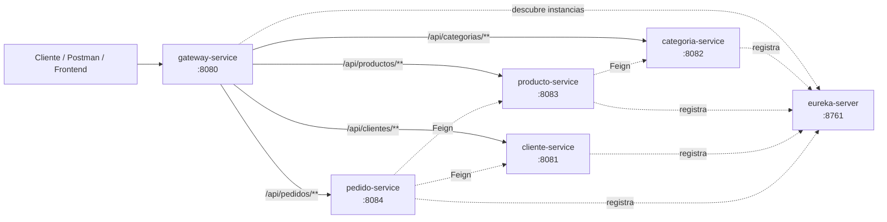

---
tags:
  - glab-s13
  - api-gateway
  - microservicios
  - conceptos
fecha: 2026-11-11
estado: completado
---

# 21 · API Gateway

> [!quote] Idea central
> Un **API Gateway** es el **único punto de entrada** a un sistema de microservicios. El cliente habla con un solo host y puerto (`http://localhost:8080`), y el gateway decide a qué servicio enrutar cada petición. Los servicios siguen existiendo por separado; el gateway solo centraliza el acceso.

## Problema que resuelve

Sin gateway, cada consumidor (web, móvil, Postman, otro equipo) debe conocer **todos** los hosts y puertos:

```text
http://localhost:8081/api/clientes
http://localhost:8082/api/categorias
http://localhost:8083/api/productos
http://localhost:8084/api/pedidos
```

Eso trae consecuencias:

- El cliente queda **acoplado a la topología** (si un servicio cambia de puerto, hay que recompilarlo).
- Cada consumidor repite **CORS, autenticación, rate limiting y logging**.
- No hay un lugar único para **observar** el tráfico de entrada.
- Se expone la red interna completa.

Con gateway:

```text
http://localhost:8080/api/clientes
http://localhost:8080/api/categorias
http://localhost:8080/api/productos
http://localhost:8080/api/pedidos
```

## Qué hace el gateway en este laboratorio

| Función | Cómo se ve en S13 |
|---|---|
| **Enrutamiento por ruta** | `Path=/api/categorias/**` → `lb://categoria-service` |
| **Balanceo de carga** | `lb://` resuelve la instancia viva vía Eureka + Spring Cloud LoadBalancer |
| **Punto único de entrada** | Todas las pruebas se hacen contra `http://localhost:8080` |
| **Traducción de errores de red** | Servicio caído → **503** controlado en JSON |
| **Observabilidad de entrada** | `logging.level.org.springframework.cloud.gateway: DEBUG` y `/actuator/gateway/routes` |
| **Descubrimiento automático** | `discovery.locator.enabled: true` crea una ruta por servicio registrado |

## Ventajas (con ejemplos de este lab)

### 1. Centralización

Un solo `baseUrl` en la colección Postman (`{{baseUrl}} = http://localhost:8080`). Cambiar de entorno es cambiar **una** variable, no cuatro URLs.

### 2. Seguridad

El gateway es el lugar natural para validar JWT, API keys, listas de IP o roles **antes** de que la petición llegue al servicio. En S13 no se implementó seguridad, pero la arquitectura ya deja el punto de intercepción: bastaría un `GlobalFilter` en `gateway-service`.

### 3. Escalabilidad

Como las rutas usan `lb://`, se pueden levantar **varias instancias** del mismo servicio en distintos puertos; Eureka las registra y el `RoundRobinLoadBalancer` reparte la carga sin tocar el cliente ni el gateway.

```text
producto-service :8083  ─┐
producto-service :8093  ─┼─► lb://producto-service ─► RoundRobin
producto-service :8094  ─┘
```

### 4. Administración de servicios

- Rutas declarativas en YAML, versionables en Git.
- `/actuator/gateway/routes` lista las rutas activas (9 en este lab: 4 explícitas + 5 del discovery locator).
- Un cambio de ruta es un cambio de configuración, no de código del cliente.

### 5. Aislamiento del cliente respecto a la topología

El cliente no sabe que `pedido-service` llama por OpenFeign a `cliente-service` y `producto-service`. Solo ve `GET /api/pedidos/1` y recibe el pedido compuesto.



## Eureka vs Gateway (no son lo mismo)

| Aspecto | Eureka (service discovery) | Gateway (API Gateway) |
|---|---|---|
| **Pregunta que responde** | ¿Dónde está la instancia viva de este servicio? | ¿A qué servicio corresponde esta URL pública? |
| **Dirección del tráfico** | Interno, servicio → servicio | Entrada, cliente → sistema |
| **Qué expone** | Un registro de nombres lógicos e IP/puerto | Un contrato HTTP estable (`/api/...`) |
| **En este lab** | `:8761`, 6 apps UP | `:8080`, 4 rutas públicas |
| **Sin él** | OpenFeign y `lb://` no resuelven nombres | El cliente necesita conocer 4 puertos |

> [!important] Se complementan
> El gateway **usa** a Eureka. `lb://categoria-service` no es una URL: es un nombre lógico que el `ReactiveLoadBalancer` resuelve consultando el registro de Eureka. Sin Eureka, `lb://` no tiene a dónde ir.

## Limitación observada

El gateway **no bloquea** el acceso directo: los servicios siguen escuchando en 8081–8084 y responden si se llaman directamente. Centralizar el acceso es una decisión de arquitectura, no un firewall.

> [!warning] Mejora pendiente
> En producción se debería: (1) exponer solo el puerto del gateway, (2) mover los servicios a una red privada, (3) desactivar el discovery locator, (4) agregar autenticación y rate limiting en el gateway.

## Enlaces

- [[22 Rutas del gateway (predicados, lb y balanceo)]]
- [[23 Discovery locator vs rutas explícitas]]
- [[24 gateway-service]]
- [[18 Eureka y service discovery]]
