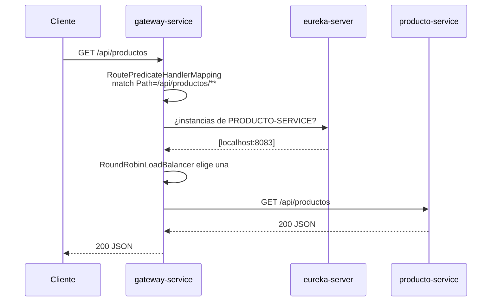

---
tags:
  - glab-s13
  - api-gateway
  - rutas
  - load-balancer
  - eureka
fecha: 2026-11-11
estado: completado
---

# 22 · Rutas del gateway (predicados, `lb://` y balanceo)

> [!info] Definición
> Una **ruta** del gateway tiene tres piezas: un **id**, un **predicado** que decide si la petición entra, y un **destino** (`uri`). Opcionalmente lleva **filtros** que modifican la petición o la respuesta.

```yaml
- id: producto-service              # nombre de la ruta
  uri: lb://producto-service        # destino (nombre lógico, no URL)
  predicates:
    - Path=/api/productos/**        # condición de entrada
```

## Predicados usados

| Predicado | Significado | Ejemplo del lab |
|---|---|---|
| `Path=/api/productos/**` | Coincide por patrón de ruta | `GET /api/productos/9` |
| `Path=/api/pedidos/**` | Cubre subrutas | `PUT /api/pedidos/7/anular` también entra |

`/**` es clave en pedidos: cubre `/api/pedidos`, `/api/pedidos/{id}`, `/api/pedidos/{id}/anular` y `/api/pedidos/{id}/atender` con **una sola ruta**. No hace falta una ruta por endpoint.

> [!note] Otros predicados que existen (no usados en S13)
> `Method`, `Header`, `Query`, `Host`, `Cookie`, `After`/`Before`/`Between`, `RemoteAddr`, `Weight`. Se combinan con `AND` dentro de la misma ruta y se pueden agrupar.

## `lb://` y balanceo con Eureka

`lb://categoria-service` significa: **“no conozco la IP ni el puerto; pregúntale a Eureka y elige una instancia”**.

Flujo real de una petición:



Componentes:

| Pieza | Rol |
|---|---|
| `spring-cloud-starter-gateway-server-webflux` | Motor reactivo de enrutamiento (Netty) |
| `spring-cloud-starter-netflix-eureka-client` | Registra el gateway y lee el registro |
| `spring-cloud-starter-loadbalancer` | Implementa `ReactiveLoadBalancer` para `lb://` |
| `RoundRobinLoadBalancer` | Estrategia por defecto: reparte en round-robin |

Evidencia en los logs DEBUG:

```text
DEBUG o.s.c.g.h.RoutePredicateHandlerMapping : Route matched: producto-service
DEBUG o.s.c.g.h.RoutePredicateHandlerMapping : Mapping [Exchange: GET http://localhost:8080/api/productos]
      to Route{id='producto-service', uri=lb://producto-service, ...}
```

## Tabla de rutas de S13

| id | Predicado | Destino | Puerto real |
|---|---|---|---|
| `categoria-service` | `Path=/api/categorias/**` | `lb://categoria-service` | 8082 |
| `producto-service` | `Path=/api/productos/**` | `lb://producto-service` | 8083 |
| `cliente-service` | `Path=/api/clientes/**` | `lb://cliente-service` | 8081 |
| `pedido-service` | `Path=/api/pedidos/**` | `lb://pedido-service` | 8084 |
| `paciente-service` | `Path=/api/pacientes/**` | `lb://paciente-service` | 8085 |
| `medico-service` | `Path=/api/medicos/**,/api/especialidades/**,/api/horarios/**` | `lb://medico-service` | 8086 |
| `cita-service` | `Path=/api/citas/**` | `lb://cita-service` | 8087 |

> [!note] Servicios de la clínica (S11)
> Son opcionales, pero se publicaron igual que los cuatro del catálogo. `medico-service` expone tres prefijos (`/api/medicos`, `/api/especialidades` y `/api/horarios`), por eso su predicado tiene varios `Path` separados por coma (se evalúan con `OR`).

Rutas extra que crea el discovery locator (una por app registrada):

| Ruta automática | Destino |
|---|---|
| `/categoria-service/**` | `lb://CATEGORIA-SERVICE` |
| `/producto-service/**` | `lb://PRODUCTO-SERVICE` |
| `/cliente-service/**` | `lb://CLIENTE-SERVICE` |
| `/pedido-service/**` | `lb://PEDIDO-SERVICE` |
| `/paciente-service/**` | `lb://PACIENTE-SERVICE` |
| `/medico-service/**` | `lb://MEDICO-SERVICE` |
| `/cita-service/**` | `lb://CITA-SERVICE` |
| `/gateway-service/**` | `lb://GATEWAY-SERVICE` (el propio gateway) |

## Cómo verificar las rutas activas

```powershell
# Lista completa (JSON) — requiere management.endpoint.gateway.access=READ_ONLY
curl.exe -s http://localhost:8080/actuator/gateway/routes

# Solo ids
(Invoke-RestMethod http://localhost:8080/actuator/gateway/routes).route_id
```

Resultado real: **15 rutas** (7 explícitas + 8 del discovery locator).

## Qué pasa cuando el destino está caído

| Situación | Resultado | Por qué |
|---|---|---|
| Eureka ya expiró la instancia | **503** `Service Unavailable` | `RoundRobinLoadBalancer`: `No servers available for service: producto-service` |
| Instancia aún en caché pero proceso muerto | 500/503 según el fallo de conexión | La caché del cliente Eureka tarda en refrescar |
| Ruta que no existe en el gateway | **404** generado por el gateway | Ningún predicado coincide |

> [!tip] Tiempo real medido
> Tras detener `producto-service`, el 503 controlado apareció a los **70–95 s** (evicción de Eureka + refresco de la caché del balanceador). Al reiniciar, la recuperación tomó **10–31 s**. Por eso en desarrollo se baja `registry-fetch-interval-seconds` y el lease.

## Orden y prioridad

Todas las rutas de S13 tienen `order: 0`. Si dos predicados coinciden, gana el orden y luego el orden de declaración. Por eso conviene que las rutas explícitas sean **más específicas** que las del discovery locator (aquí lo son: `/api/...` vs `/{service-id}/...`).

## Enlaces

- [[21 API Gateway]]
- [[23 Discovery locator vs rutas explícitas]]
- [[24 gateway-service]]
- [[18 Eureka y service discovery]]
